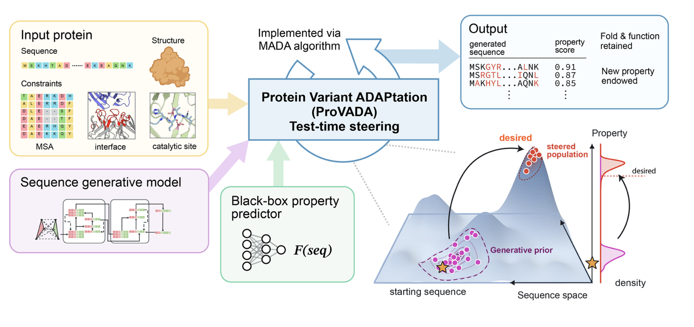
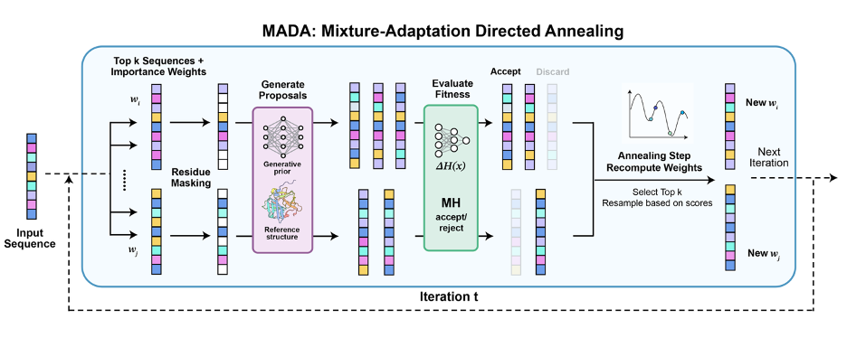

<div align="center">

# ProVADA 

### Generative steering to adapt proteins beyond native biological contexts

[](https://github.com/SUwonglab/provada-dev/actions/workflows/unit_tests.yml)
[](https://github.com/SUwonglab/provada-dev/actions/workflows/flake8_check.yml)
[](./LICENSE)
[](https://www.python.org/downloads/)
[](https://www.biorxiv.org/content/10.1101/2025.07.11.664238v2)
[![Built on proto-tools](https://img.shields.io/badge/Built_on-proto--tools-046e7a?logo=data%3Aimage%2Fpng%3Bbase64%2CiVBORw0KGgoAAAANSUhEUgAAACAAAAAgCAYAAABzenr0AAAD10lEQVR42sWXQYhWVRTHf%2B%2FNNzYWiiKZDVZY1iKjmjCiEqKMalEMBEFUi2hhtRkKpRZGFhUS2joRAkmpIFCiXGSricJqI4VJRA2M4ZjaWIHQlPN9vxadZ6fH%2B76ZgZEuXN5795577v%2Bec%2F73nFeo%2FJ%2BtnGGuPN8AWg1jRfROAtLpArAA7DI%2Fq1bUXFApBBgKxV%2FXxntZbO5A1KoXaqkuV%2Ff7T2urr8V8meRQ16rD6lDSkXX1JdmuPX9UG9weACb8t62Pub7oqHsTyFH1nrRx1tsTSC90y9Q3Y5ODSVl%2FKNymno2uujttvlS9W10xGwtUp2rV3iuh0djgsfgeiOd7Mf67OpJOOaSOxdwp9eVwa9FkiV7oBuK0j6sd9YR6ecwNqqfVSXVV8vsDNdcZYO6PQ%2FU3AdgQ5nsh%2FHhJTejqpOzT%2BK6s8rl6r7pdPZTkflF3qXfN5ILC5qvwe%2BAIcAJYDgwnqv0BLASmGy6rg8AeYB9wPI3fBjwV4%2FuC1gAW6gbgTCi9DLgeuBlY2QCsDfSlJ8BPwF7gXeDLJNsfcpcCXwGDMb4V2HzuXulimkK9Jvy%2FW%2F0xmbcdzwPqI%2BqS2roczAuCQQZb3lCvC8ovUgtiQe59DYAWqjeqn4WyFxu4XtZAoO5Jmz9cWzOqbu9lgTIBqpQ%2FFwpXhcyCBmpVkb41WeylGLtQXaO%2BE3NnmClKk9JSfT4Wrksnz6CrzTelk6seVo%2BoJ2sUtTXblBGJpko2SxsyaB9wFngG2AZMRSAKrAm5byNgJ4BlQLs119xVS%2BNFYsV0RPerMTeQ1u0CtgBH05rpnNNb0cvE0V4A%2BtO6dmy2MzbvAB%2FH9ychfzGwGBgJ2l4ba%2Fu7%2BbzKB1XwVVG9MVw3kmRvSlQbU%2B%2Bo6bozxUJF33PZt8pcm9QngvtlAyMGAsSzoeRtdXHUClMx9o16ZQraC4IlqFvSFb06sQyCFj8nhD%2Bob0X2u6oG5pWQOa2Ox3tH3dmDQaX6qDqdckOZc0EVMA8BDwLrgUXhu7%2BAQ8CByAub42qt2lTEzYfAF8ASYHVcuxPARuBY6P0T2B%2B%2Bn84lWdFQiAyrHwXqptaJ3qsdV1fW9NfdS6uh2JwEPghO3xKnajUwoQ28D4wDvwIno58KHUf%2Fc9IuRWvlgsHIgmsjda5LbgD4DjgM3AqsCB4%2FDeyYqeqesZpWX4%2ForNpk0GqH%2BmQkoeqKvS9kjsVYVSO2almwnE1FXAXhkrgoOmHK37rU933ARRFUY8AN8%2FFnVHT5N8yVTifMWAleEc%2Fx%2BQJQ5BKp9jzvrVU73Vx%2BaDvzBWCurTOfFvgbbKewKbKym8AAAAAASUVORK5CYII%3D)](https://github.com/evo-design/proto-tools)

**[Preprint](https://www.biorxiv.org/content/10.1101/2025.07.11.664238v2) · [Renin example](./inputs/renin/README.md)**

**Xiaowei Zhang**<sup>1,†,*</sup>, **Wenhui Sophia Lu**<sup>2,†</sup>, **Ben Viggiano**<sup>3,4,†</sup>, Kevin Reynolds<sup>5</sup>, Sophia Burick<sup>6</sup>, Elena Sotillo<sup>5,7</sup>, Haoyu Dai<sup>8</sup>, Geonhu Lee<sup>8</sup>, Zixuan Liu<sup>1</sup>, Nuoya Yang<sup>9</sup>, Luis S. Mille-Fragoso<sup>1,16</sup>, Euan Ashley<sup>3,10,11</sup>, Bingfei Yu<sup>9,12,13</sup>, Crystal L. Mackall<sup>5,7,10,14,15</sup>, Wing Hung Wong<sup>2,3,16,*</sup>, Xiaojing J. Gao<sup>8,16,*</sup>

<details>
<summary><sub><b>Affiliations</b></sub></summary>
<br>
<sub>
<sup>1</sup> Department of Bioengineering, Stanford University, Stanford, USA.<br>
<sup>2</sup> Department of Statistics, Stanford University, Stanford, USA.<br>
<sup>3</sup> Department of Biomedical Data Science, Stanford University, Stanford, USA.<br>
<sup>4</sup> Department of Computer Science, Stanford University, Stanford, USA.<br>
<sup>5</sup> Stanford Center for Cancer Cell Therapy, Stanford Cancer Institute, Stanford University, Stanford, USA.<br>
<sup>6</sup> Biophysics Program, Stanford University, Stanford, USA.<br>
<sup>7</sup> Weill West Coast Cancer Hub, Stanford, USA.<br>
<sup>8</sup> Department of Chemical Engineering, Stanford University, Stanford, USA.<br>
<sup>9</sup> Department of Immunology and Immune Therapeutics, Keck School of Medicine, University of Southern California, Los Angeles, USA.<br>
<sup>10</sup> Department of Medicine, Stanford University, Stanford, USA.<br>
<sup>11</sup> Center for Undiagnosed Diseases, Stanford University, Stanford, USA.<br>
<sup>12</sup> Norris Comprehensive Cancer Center, University of Southern California, Los Angeles, USA.<br>
<sup>13</sup> Alfred E. Mann Department of Biomedical Engineering, University of Southern California, Los Angeles, USA.<br>
<sup>14</sup> Department of Pediatrics, Stanford University, Stanford, USA.<br>
<sup>15</sup> Parker Institute for Cancer Immunotherapy, San Francisco, USA.<br>
<sup>16</sup> Stanford Bio-X, Stanford University, Stanford, USA.<br>
</sub>
</details>

<sub>
<sup>†</sup> These authors contributed equally to this work.<br>
<sup>*</sup> Corresponding authors: <a href="mailto:xjgao@stanford.edu">xjgao@stanford.edu</a> (X.J.G.), <a href="mailto:whwong@stanford.edu">whwong@stanford.edu</a> (W.H.W.), <a href="mailto:zhangxw@stanford.edu">zhangxw@stanford.edu</a> (X.Z.)
</sub>

&nbsp;



</div>

This repository contains the official implementation of **ProVADA** (**Pro**tein **V**ariant **Ada**ptation), a test-time framework for adapting existing proteins to new biological contexts. Starting from a reference sequence, ProVADA steers a pretrained protein generator toward desired properties while preserving fold and native functionality.

### Publications
- Pre-Print: Zhang, Lu, Viggiano et al. [Generative steering to adapt proteins beyond native biological contexts](https://www.biorxiv.org/content/10.1101/2025.07.11.664238v2). bioRxiv (2026). doi:10.1101/2025.07.11.664238


## What is ProVADA?

At its core, ProVADA uses an iterative, population-based sampling algorithm called **MADA** (Mixture-Adaptation Directed Annealing) to explore the protein sequence space. At each iteration, promising sequences are selected through a downsampling and upsampling process, partially masked, and then re-completed to generate new proposals. These proposals are accepted or rejected based on a fitness score, guiding the population toward the desired properties.

See the [sampler documentation](provada/sampler/README.md) for sampling policies,
fitness options, and the metrics a run logs.

<div align="center">



<sub><i>An illustrated example of the MADA algorithm utilizing ProteinMPNN as a generator.</i></sub>

</div>


### Set up
We have created a start up script that installs all dependencies and sets up the conda environment `provada-env`. Please use the following commands to create and activate the environment:

```bash
bash create_env.sh
conda activate provada-env
```


## Example

We have provided example inputs for the experiments in the preprint under the
`inputs` directory. Each has its own README describing the target, the files and
what the configuration optimizes.

### Renin localization: [inputs/renin](./inputs/renin/README.md)

Adapt a secreted protease to the reducing cytosol.

```bash
python run_provada.py --config inputs/renin/renin_localization_mpnn.yaml
```

### FMC63 deimmunization: [inputs/fmc63](./inputs/fmc63/README.md)

Lower predicted MHC class I presentation of the anti-CD19 CAR binder.

```bash
python run_provada.py --config inputs/fmc63/fmc63_deimmune_mpnn.yaml
```

### SunTag scFv deimmunization: [inputs/scfvgcn4](./inputs/scfvgcn4/README.md)

The same objective for the second scFv, excluding new cysteines.

```bash
python run_provada.py --config inputs/scfvgcn4/scfvgcn4_deimmunize_mpnn.yaml
```

Both deimmunization examples predict epitopes with netMHCpan, which is
license-gated and has to be installed once before they will run.

## Repository Structure

```
provada-dev/
├── provada/                    # Main package source code
│   ├── components/            # Core components: Evaluators, Generators
│   │   ├── README.md          # Component system overview
│   │   ├── EVALUATORS.md      # Guide to creating custom scoring functions
│   │   ├── GENERATORS.md      # Guide to creating custom sequence generators
│   │   ├── evaluator.py       # Evaluator base class and built-in evaluators
│   │   └── generator.py       # Generator base class and built-in generators
│   ├── sampler/               # Sampling algorithms (MADA, Rejection, etc.)
│   ├── sequences/             # Sequence processing and pairwise metrics
│   ├── tools/                 # Model toolkits, each run in an isolated environment
│   ├── utils/                 # Utilities (logging, config, registry, etc.)
│   ├── base_variant.py        # Base variant class for starting protein
│   ├── config.py              # Typed configuration schema
│   ├── paths.py               # Path configuration
│   └── README.md              # Package-level documentation
├── inputs/                    # Input files and configurations
│   └── renin/                 # Example: renin localization experiment
├── tests/                     # Test suite
├── results/                   # Output directory for experimental results
├── logs/                      # Application logs
├── wandb/                     # Weights & Biases experiment tracking
├── run_provada.py             # Main entry point for running experiments
├── run_multiple.py            # Run multiple experiments in parallel (multi-GPU)
└── conftest.py                # Pytest configuration
```

## Core Components

ProVADA's modular design is built around two extensible component types:

- **[Evaluators](provada/components/EVALUATORS.md)** - Score protein sequences based on desired properties (localization, stability, etc.)
- **[Generators](provada/components/GENERATORS.md)** - Generate new sequences by filling masked positions (ESM3, ProteinMPNN, etc.)

See the [Components README](provada/components/README.md) for detailed guides on creating custom evaluators and generators. In addition, our repository builds on the open-source infrastructure of the [proto-tools](https://github.com/evo-design/proto-tools) project. See the proto-tools [documentation](https://proto.evodesign.org/docs/tools/introduction) for more information on how our model deployments work.

## Tests

To run tests to ensure all functionality works, use the following command:
```bash
pytest -sv
```
