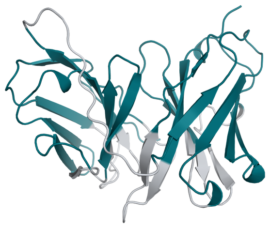

# FMC63 Deimmunization Example

This example redesigns the framework of FMC63, the murine anti-CD19
single-chain variable fragment (scFv) used in CD19 CAR-T cells. The objective is
to reduce predicted HLA class I binding of peptides from the scFv while keeping
its antigen-binding regions fixed.

<div align="center">



<sub><i>Designable residues are shown in teal and fixed residues in grey. Of the 242 residues, 167 are designable.</i></sub>

</div>

## Run the Example

From the repository root:

```bash
python run_provada.py --config inputs/fmc63/fmc63_deimmune_mpnn.yaml
```

Install netMHCpan before running this example; see the setup instructions in
[proto-tools](https://github.com/evo-design/proto-tools). Peptides present in the
human proteome are excluded from scoring. The reference human peptidome is
downloaded automatically on first use.

## Design Setup

The six complementarity-determining regions (CDRs) and the GS linker are held
fixed, leaving 167 framework residues available for redesign. The four cysteines
are designable. ProteinMPNN uses the predicted scFv structure to generate
variants.

netMHCpan scores nine-residue peptides against `HLA-A*02:01` and `HLA-B*07:02`.
The objective combines the immunogenicity score and the ProteinMPNN score with
weights of 1.0 and 0.1, respectively. The run uses 200 iterations and a
population of 50.

## Files

| File | Description |
| --- | --- |
| [fmc63_seq.txt](./fmc63_seq.txt) | Reference FMC63 sequence, 242 residues, with the light-chain variable domain joined to the heavy-chain variable domain by a GS linker. |
| [fold_fmc63_monomer_model_0.cif](./fold_fmc63_monomer_model_0.cif) | Predicted scFv structure used to condition ProteinMPNN. |
| [7urv_chain_d_renum_with_gap.pdb](./7urv_chain_d_renum_with_gap.pdb) | Experimental FMC63 structure from chain D of PDB 7URV, renumbered to match the reference sequence. Unresolved linker residues are listed in `REMARK 465`. This structure is provided as an alternative to the predicted structure. |
| [fmc63_fixed_residues.txt](./fmc63_fixed_residues.txt) | 75 fixed positions covering the CDRs, as reported for huCTL019, and the `GGGGSGGGGSGGGGS` linker. Positions are 1-indexed. |
| [fmc63_deimmune_mpnn.yaml](./fmc63_deimmune_mpnn.yaml) | Configuration for this example. |
