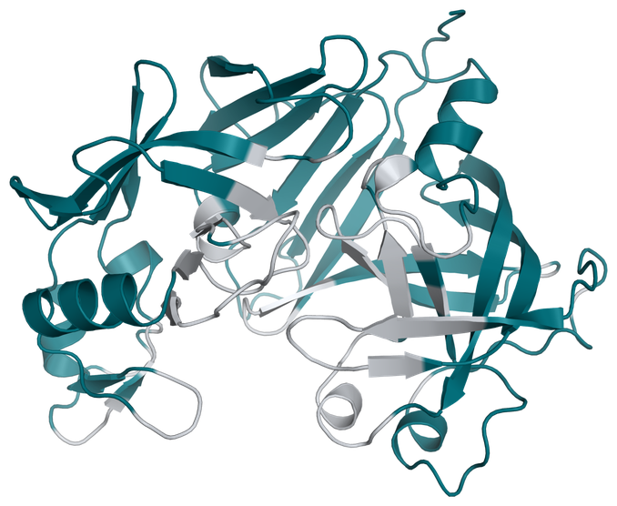

# Renin Localization Example

This example uses ProVADA to redesign human renin for activity in the cytosol.
ProteinMPNN proposes variants, and a localization classifier scores their
predicted compatibility with the cytosolic environment.

<div align="center">



<sub><i>Designable residues are shown in teal and fixed residues in grey. Of the 340 residues, 244 are designable.</i></sub>

</div>

## Run the Example

From the repository root:

```bash
python run_provada.py --config inputs/renin/renin_localization_mpnn.yaml
```

## Design Setup

Renin is a secreted aspartic protease that cleaves angiotensinogen. Adapting it
to the reducing cytosol requires changes to its sequence while retaining the
catalytic machinery.

The configuration fixes 96 of 340 residues, including conserved positions and
residues near the substrate-binding site. The remaining 244 positions are
designable. The objective combines predicted cytosolic localization probability
with penalties for sequence divergence and the ProteinMPNN score, with weights
of 1.0, 0.2, and 0.1, respectively.

The run uses 300 iterations, a population of 30, and a ProteinMPNN sampling
temperature of 0.5. New cysteines are excluded. The paper's renin campaign also
used an ESM-2 pseudo-perplexity penalty; that term is not included in this
example.

## Files

| File | Description |
| --- | --- |
| [example_seq_renin.txt](./example_seq_renin.txt) | Reference human renin catalytic-domain sequence, 340 residues. |
| [renin_af3.pdb](./renin_af3.pdb) | AlphaFold 3 structure used to condition ProteinMPNN. |
| [logreg_model.pkl](./logreg_model.pkl) | Trained logistic regression classifier that predicts cytosolic localization probability from ESM-2 embeddings. |
| [train_localization_classifier.py](./train_localization_classifier.py) | Script for training the classifier on UniProt subcellular localization data. |
| [conserved_positions.txt](./conserved_positions.txt) | Six fixed positions identified from the ConSurf multiple sequence alignment, excluding cysteines. Positions are 1-indexed. |
| [interface_positions.txt](./interface_positions.txt) | 92 fixed positions with a heavy atom within 8 Å of the substrate segment in the predicted complex, including the two catalytic residues. Positions 129 and 316 also occur in the conserved set. |
| [renin_localization_mpnn.yaml](./renin_localization_mpnn.yaml) | Configuration for this example. |
