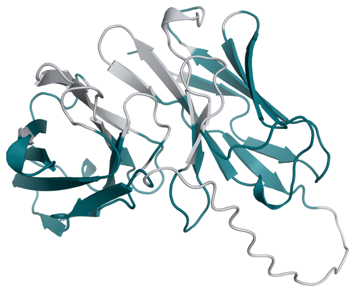

# SunTag scFv Deimmunization Example

This example redesigns the anti-GCN4 single-chain variable fragment (scFv) used
in the [SunTag tagging system](https://pubmed.ncbi.nlm.nih.gov/25307933/). As in
the [FMC63 example](../fmc63/README.md), the objective is to reduce predicted HLA
class I binding of peptides from the scFv while keeping selected binding and
structural residues fixed.

<div align="center">



<sub><i>Designable residues are shown in teal and fixed residues in grey. Of the 244 residues, 161 are designable.</i></sub>

</div>

## Run the Example

From the repository root:

```bash
python run_provada.py --config inputs/scfvgcn4/scfvgcn4_deimmunize_mpnn.yaml
```

Install netMHCpan before running this example; see the setup instructions in
[proto-tools](https://github.com/evo-design/proto-tools). Peptides present in the
human proteome are excluded from scoring. The reference human peptidome is
downloaded automatically on first use.

## Design Setup

The configuration fixes 83 of 244 residues: the CDRs and vernier-zone residues
under the Martin numbering scheme, plus the linker at positions 112–131. The
four cysteines are left designable, but `excluded_amino_acids: ["C"]` prevents
new cysteines from being introduced. Existing cysteines can therefore be
replaced during design.

netMHCpan scores nine-residue peptides against `HLA-A*02:01` and `HLA-B*07:02`.
The objective combines the immunogenicity score and the ProteinMPNN score with
weights of 1.0 and 0.2, respectively. The run uses 300 iterations and a
population of 40, with the masking fraction decreasing linearly from 0.1 to
0.008.

## Files

| File | Description |
| --- | --- |
| [wt_seq.txt](./wt_seq.txt) | Reference anti-GCN4 scFv sequence, 244 residues, with the light-chain variable domain joined to the heavy-chain variable domain. |
| [fold_scfvgcn4_monomer_model_0.cif](./fold_scfvgcn4_monomer_model_0.cif) | Predicted scFv structure used to condition ProteinMPNN. |
| [scfvgcn4_fixed_positions_martin_excludecys.txt](./scfvgcn4_fixed_positions_martin_excludecys.txt) | 83 fixed positions, indexed from 1. The name `excludecys` indicates that cysteines are excluded from the fixed set. |
| [scfvgcn4_deimmunize_mpnn.yaml](./scfvgcn4_deimmunize_mpnn.yaml) | Configuration for this example. |
